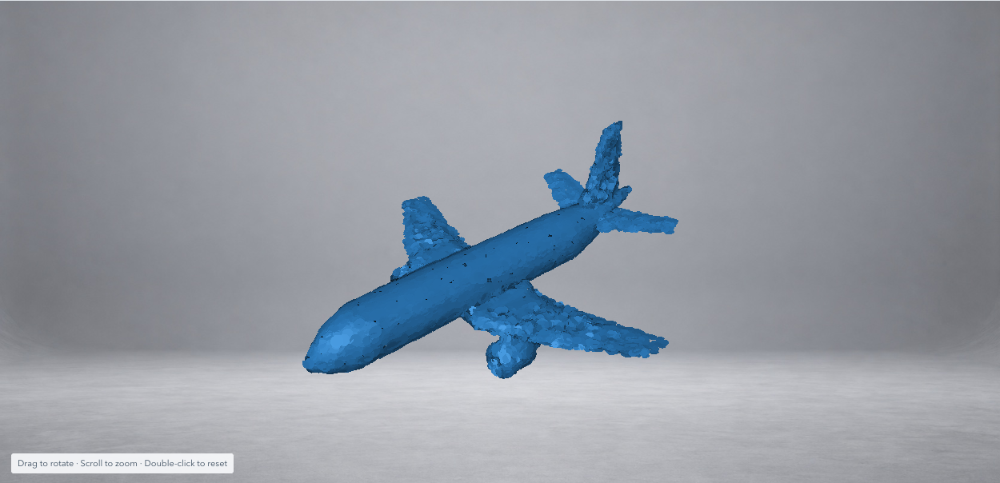
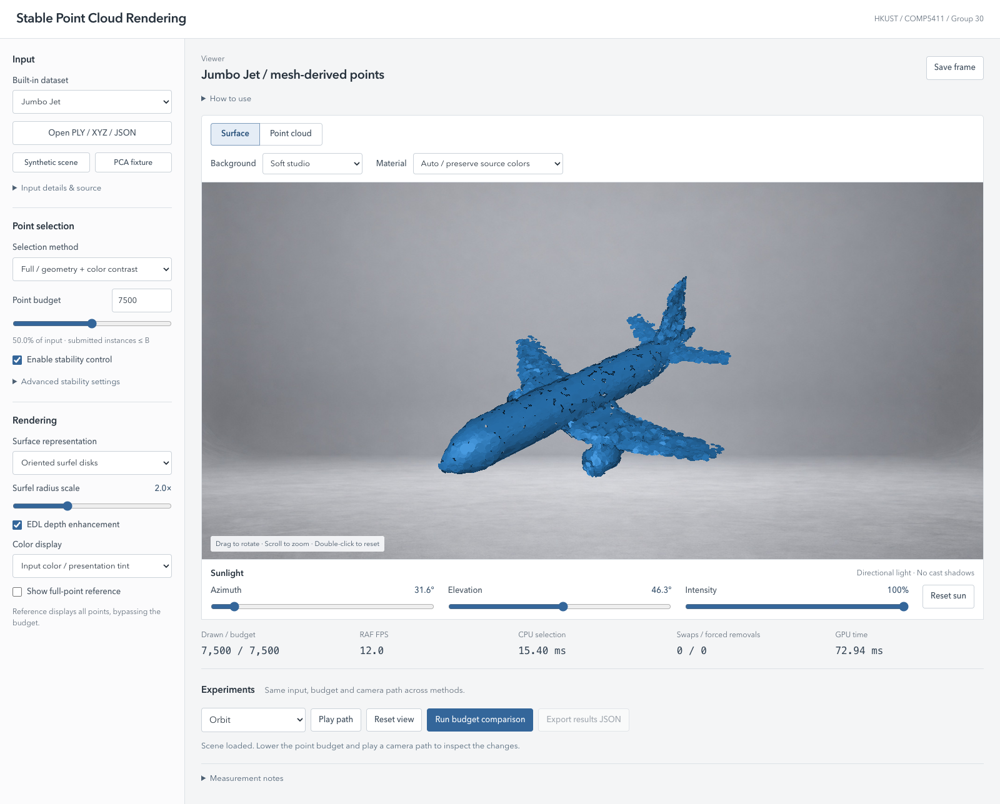

# COMP5411 Group 30 — Stable Point Cloud Renderer

**Saliency- and Geometry-Aware Temporally Stable Point Cloud Rendering**

A computer graphics research prototype for rendering static point clouds with a fixed surfel budget. It combines geometry and appearance cues with stateful point selection, and exposes the quality, coverage, stability, and responsiveness trade-offs in an interactive WebGL2 viewer.

**Team:** GAO, Yuanchen · ZHOU, Ziyu

**Course:** COMP5411, HKUST · Fall 2026

**Status:** runnable prototype; the full research experiment matrix is still planned.

*An actual render from this application, using the bundled aircraft point cloud. It is a full-point reference rendered with opaque surfels, not an AI-generated result.*

The documentation screenshots show the current English interface. [Screenshot settings](docs/images/capture-manifest.json) record the 22 November 2026 capture; historical experiment values remain in their original result files.

## Quick start

The viewer needs **Python 3.10+** and a browser with **WebGL2** enabled. No frontend build, npm installation, CDN, or Python numerical dependency is needed to view the bundled inputs.

~~~sh
git clone https://github.com/YuanchenGaoUST/COMP5411-Group30-stable-pointcloud-renderer.git
cd COMP5411-Group30-stable-pointcloud-renderer
python3 scripts/serve.py --port 5411
~~~

Open:

- [Viewer](http://127.0.0.1:5411/)
- [Aircraft preview](http://127.0.0.1:5411/?dataset=jetliner)
- [Aircraft as individual points](http://127.0.0.1:5411/?dataset=jetliner&view=points)

On macOS, double-click `start.command`, or run `./start.command`. The launcher uses Python from your PATH; `PYTHON_BIN` and `PORT` can override its defaults.

If port 5411 is already occupied:

~~~sh
python3 scripts/serve.py --port 5412
~~~

The development server binds to `127.0.0.1`. Keep it running while using the viewer; opening `index.html` directly bypasses the local HTTP setup required by its modules and data loading.

The interface is entirely in English. Select an input under **Built-in dataset**, drag to rotate, and scroll to zoom. Change the point budget and play a camera path to inspect coverage and temporal changes.

### First session: a short walkthrough

1. Open the [aircraft preview](http://127.0.0.1:5411/?dataset=jetliner). It starts with 7,500 of the model's 15,000 points. Drag to rotate, scroll to zoom, and double-click to reset the view.
2. In **Point selection**, try budgets of 7,500, 3,000, and 1,500. Keep **Show full-point reference** off while exploring budgeted rendering: that checkbox intentionally draws the full input instead.
3. Select **Orbit** under **Experiments**, then **Play path**. Switch **Enable stability control** off and on to inspect changes. The button shows **Pause path** during playback; dragging, zooming, resetting, changing input, or starting an experiment stops it.
4. Try **Uniform**, **Screen**, **Geometry**, and **Full** at the same budget. The aircraft has no source colors, so Full and Geometry have the same scores on this input. Choose a colored synthetic scene to investigate the color-contrast term.
5. Click **Run budget comparison**, wait for the table, then **Export results JSON**. This short diagnostic evaluates all methods and applicable stability variants, not just the method currently selected in the viewer. Keep the tab open while it runs.
6. **Save frame** downloads the current rendered PNG. **Background**, **Material**, and **Sunlight** adjust presentation; quantitative comparisons retain the documented original-material policy.

The viewer has a compact, neutral light interface ([actual interface preview](docs/images/viewer-interface.png)). **How to use** opens the inline guide. **Input details & source**, **Advanced stability settings**, and **Measurement notes** expose the technical details without crowding the default view. Display notes have been removed from the interface; background attribution and material policies remain documented below and in docs/AI_USAGE.md. On narrow screens, the input and selection controls appear below the viewer and experiments.

### Point-cloud view

Use **Point cloud** above the canvas to display small circular dots at the actual input positions. **Point size** controls their diameter from 1 to 6 CSS pixels. Dots do not use normals, surfel radii, surface lighting, or EDL. **Surface** restores the existing shaded surfels (or the selected legacy screen-facing splats). Switching views preserves the camera, point budget, and selector state; it does not generate a mesh or change the input data.

The point-cloud view still displays the budgeted selection. To inspect all input points, enable **Show full-point reference**. Auto preserves colored input, and gives explicitly uncolored inputs a blue display tint; **Original** displays input colors or the recorded fallback. Other materials become flat tints in this view, not highlights or recovered textures. Color diagnostics remain available.

The point-cloud view is an inspection mode. **Run budget comparison** always uses the surface rendering path, Original material, and standard EDL strength; it retains the chosen surface primitive and EDL checkbox setting. Exports distinguish actual `rendering` from requested `presentationRendering`, including the requested view and dot size. On completion the viewer returns to the selected display mode. Dot sizes are expressed as CSS pixels in the UI and as framebuffer pixels in the renderer API.

Use the viewer in a browser tab; do not open `index.html` as a local file. If the localhost link stops working after restarting the computer, run `start.command` again and keep its terminal window open. Press **Ctrl+C** in that terminal to stop the server.

## Viewer features

- Static ASCII PLY, XYZ, and processed JSON input.
- Seven built-in input options: two synthetic scenes and five online model-derived point clouds.
- Four selection modes: Uniform, Screen, Geometry, and Geometry + color contrast.
- A hard submitted-instance budget, time-based score smoothing, hysteresis, and a paired replacement quota.
- Oriented surfel disks or screen-facing point sprites, depth testing, and an EDL-inspired post-pass.
- Interactive sunlight: world-space azimuth, elevation, and intensity controls beneath the canvas, with a reset to the original lighting.
- Presentation backgrounds: Soft studio, Open sky, Blue lab, and the original solid diagnostic background.
- Repeatable orbit, zoom, boundary-crossing, and abrupt-cut camera paths.
- A full-point reference view, frame export, and short method/stability experiments with JSON output.

The **full-point reference** checkbox deliberately bypasses the budget so that the complete input can be inspected. It is separate from the budgeted selection methods.

## Technical approach

~~~text
Static points
    |
    v
Offline normals, support radii, geometry, and color contrast
    |
    v
Persistent point IDs + octree candidate discovery
    |
    v
Fixed-budget selection + temporal control
    |
    v
WebGL2 surfel splatting, depth testing, and optional EDL
    |
    v
Displayed image + reproducible diagnostic measurements
~~~

Each surfel stores a position, normal, support radius, and color. The GPU expands it into a small oriented quad and rejects fragments outside its circular footprint. The quad uses rasterization triangles internally, but the application does not reconstruct triangle connectivity between input points.

The current renderer uses **opaque, depth-tested disks**. It is a simplified point-based renderer rather than a full EWA surface-splatting implementation.

### Interactive sunlight

The **Sunlight** panel beneath the canvas controls a directional light. Drag **Azimuth** to move it around the model, **Elevation** to raise it, or **Intensity** to dim it. **Reset sun** restores the original direction `[0.4, 0.8, 0.65]` and intensity. The light stays fixed in world space as the camera moves.

Shading uses `0.42 + 0.58 * intensity * abs(normal · lightDirection)`, with unit vectors in the dot product and intensity in `[0, 1]`. Ambient fill remains at zero sun intensity. The two-sided diffuse term tolerates flipped PCA normals, so opposite light directions produce the same brightness. This is an interactive shading aid, without cast shadows, sky simulation, or new surface reconstruction.

Light changes do not reset selection or change the point budget, geometry scores, or offline color-contrast features. They do change RGB image measurements. Comparison runs lock the sunlight controls, use the same captured settings for every method and full-point reference, and export those settings under `rendering.sunlight`. Keep lighting fixed for temporal-stability experiments. The default/reset lighting preserves the original rendering formula used in the archived pilot.

### Surface materials

Use **Material** above the canvas to choose **Auto**, **Original / input colors**, **Blue enamel**, **Warm copper**, or **Jade satin**. Auto uses blue enamel only when an input explicitly reports `metadata.hasColors === false`; colored or unknown-color inputs keep Original. An explicit material choice remains selected when switching datasets.

The three artistic presets add a base tint, broad view-dependent sun highlights, and softer EDL depth shading (strengths 4, 4.5, and 3.5 respectively, versus the original 14). They use a simple two-sided diffuse / Blinn–Phong shader, not recovered textures, physically measured materials, or environment reflections. Geometry and color-contrast diagnostic views bypass the presets. Point positions, normals, radii, input colors, feature scores, IDs, and budgets are unchanged. Sparse coverage and surfel boundaries can still be visible.

Material styling changes foreground RGB in both the displayed image and `renderer.capture()`. To preserve the existing comparison protocol, **Run budget comparison** always uses **Original material with EDL strength 14** (when EDL is enabled), and locks the controls during the run. The JSON records actual measurement settings under `rendering` and requested viewer styling under `presentationRendering`. Sunlight and the other controls retain their existing fixed-per-run behavior. The chosen material is restored automatically for live viewing afterward.

*Same point-cloud geometry and 7,500-point budget, with artistic surface shading and an AI-generated backdrop. This software-rendered preview is not a GPU performance benchmark.*

### Presentation backgrounds

Use **Background** above the canvas to choose **Soft studio**, **Open sky**, **Blue lab**, or **Solid / diagnostic**. The three image backgrounds are AI-generated, fixed 2D decorations with a centered cover crop. They do not provide environment lighting, geometry, shadows, or camera parallax. Sunlight remains an independent shading control. Full generation prompts and image provenance are recorded in [assets/backgrounds/generation.json](assets/backgrounds/generation.json).

Background images are composited only onto the final displayed canvas. **Save frame** includes the selected decoration, while `renderer.capture()` and all image-quality measurements retain the exact original solid background and depth. Changing the background does not change point selection, surfel shading, or measured RGB/depth. Comparison runs lock the background selector and record the display choice as `rendering.background`, together with `rendering.captureBackground: "legacy-solid"`, in the exported JSON.

The GPU timer covers surfel rendering and the EDL post-pass; it excludes the final background presentation pass. Its value is not the total cost of drawing the decorated viewer. Software-browser checks establish functionality, not native-GPU performance.

### Importance and stable selection

The initial importance rule is:

~~~text
a_i(t) = e_i(t) * [1 + w_g g_i c_i + w_s s_i + w_v b_i(t) c_i]
b_i(t) = 1 - |normal_i · viewing_direction_i(t)|
~~~

- `e`: bounded, logarithmically compressed projected surfel support, not a measured reconstruction error.
- `g`: normalized neighborhood geometry variation.
- `s`: offline center–surround color contrast, used as an appearance proxy.
- `c`: confidence in the local geometric estimate.
- `b`: a grazing-angle proxy, not an explicit occlusion-silhouette detector.

Screen uses projected support. Geometry adds confidence-weighted geometry and grazing-angle cues. Full uses the same terms and adds color contrast. Initial weights are `w_g = 1`, `w_s = 1`, and `w_v = 0.5`; their effectiveness still requires evaluation.

Uniform is currently a shared spatial-cover baseline with deterministic hashed fill, rather than a complete equal-screen-density sampler.

Stable selection maintains point identity across updates, smooths scores with a time-based EMA, and requires a relative improvement before replacing a retained point. At most `floor(quota * B)` discretionary paired swaps occur per update. Initialization, visibility removals, and empty-slot fills are recorded separately.

The submitted-instance count remains `<= B`. The replacement quota does not add capacity. Live selection runs at up to 30 Hz; diagnostic experiments advance selectors at a fixed 30 Hz. A point-count cap controls primitive count, not a guaranteed frame-time limit.

## Bundled data and provenance

| Input | Points | Source / provenance | Useful features |
|---|---:|---|---|
| Analytical multi-depth scene | 14,400 | Deterministic synthetic scene with analytical normals and disclosed design proxies | Depth variation, thin tubes, color patches, occlusion |
| Neighborhood PCA fixture | 8,192 | Synthetic surfaces with computed neighborhood features | Coverage, noise, curvature and appearance checks |
| Jumbo Jet / wide-body aircraft | 15,000 | [NuclearOsmosis, OpenGameArt](https://opengameart.org/content/jumbo-jetwide-body), CC0 | Thin wings, engines, fuselage and tail |
| Funky aircraft | 15,000 | [Savino, OpenGameArt](https://opengameart.org/content/funky-aircraft), CC0 | Smooth aircraft surfaces |
| Stanford Bunny | 15,000 | [Stanford Computer Graphics Laboratory](https://graphics.stanford.edu/data/3Dscanrep/), research-use terms | Curved body, thin ears, source holes |
| Stanford Dragon | 15,000 | [Stanford Computer Graphics Laboratory](https://graphics.stanford.edu/data/3Dscanrep/), research-use terms | Fine and complex geometric features |
| Utah Teapot | 15,000 | [McGuire archive](https://casual-effects.com/g3d/data10/), [per-model CC0 metadata](https://casual-effects.com/g3d/data10/common/model/teapot/info.js) | Spout, handle and cavities |

The five online-model inputs are **mesh-derived surface samples**, not raw scanner measurements. They use deterministic, area-weighted triangle-surface sampling followed by neighborhood preprocessing.

Those five inputs have no source vertex colors. The viewer uses a disclosed pearl-white fallback and their color saliency is zero. **Full and Geometry therefore score identically on these uncolored inputs.** Use the colored synthetic scenes, and later licensed colored scans, to study the appearance term.

Model previews start with a 50% point budget for readability. This does not change the planned experimental budgets of 5%, 10%, and 20%.

Processed point clouds are included, so a fresh clone can display every option offline. Original downloaded meshes and archives are ignored by Git. Author credits, source URLs, sampling seeds, and hashes are recorded in:

- [Dataset catalog](data/catalog.json)
- `data/models/*.json` metadata
- [Source cache and attribution notes](data/sources/README.md)

### Rebuild the online-model point clouds

Install the numerical preprocessing dependency:

~~~sh
python3 -m venv .venv
source .venv/bin/activate
python3 -m pip install -r requirements.txt

python3 scripts/fetch_model_sources.py
python3 scripts/build_model_catalog.py --count 15000 --seed 20261010
~~~

The download script preserves existing source files. The build script reads named archive members, samples the meshes, computes features, and regenerates the local catalog.

The original Stanford datasets retain their own research-use and acknowledgment requirements; they are not relicensed as CC0 or MIT.

## Custom input and preprocessing

For an ASCII point cloud:

~~~sh
python3 scripts/preprocess.py data/raw/scan.ply data/scan.json
python3 scripts/preprocess.py data/raw/scan.ply data/scan-noisy.json --noise 0.01 --seed 20261010
~~~

Noise is applied in normalized geometry units and features are recomputed. Point IDs remain stable for paired comparisons.

For an OBJ or ASCII/binary PLY **mesh**:

~~~sh
python3 scripts/sample_mesh.py data/sources/jetliner.obj data/models/custom-jetliner.json \
  --count 15000 --seed 20261010 --name Jetliner \
  --source-url https://opengameart.org/content/jumbo-jetwide-body --license CC0-1.0
~~~

The raw point-cloud importer and `preprocess.py` currently support ASCII PLY/XYZ. Binary PLY support is available in the mesh-sampling path, not the raw browser importer.

NumPy alone supports exact neighborhood preprocessing up to **16,000 points**. For larger inputs, install optional SciPy:

~~~sh
python3 -m pip install 'scipy>=1.11'
~~~

The browser currently enforces a **100,000-point** interactive limit.

Processed JSON uses a versioned schema with flat arrays:

~~~text
version, name, count
positions, normals, colors
radii, geometry, saliency, confidence
ids, metadata
~~~

Missing raw-input features are explicitly marked as fallbacks. A successful preview does not mean that unavailable geometric features have been estimated.

## Experiments and measurements

[experiments/plan.json](experiments/plan.json) contains the **planned protocol**, not measured results. It defines dataset families, budget ratios, method/stability ablations, camera paths, noise tests, and reproducibility records.

Short experiments in the viewer:

1. Hold input, budget, camera poses, viewport, shader, radius policy, sunlight, and EDL settings fixed.
2. Advance all method/stability variants together at 30 Hz.
3. Share one candidate pool, including the union of visible retained IDs.
4. Render the full-point reference and budgeted images.
5. Export per-frame measurements and settings.

Metrics include RGB MAE, foreground holes, silhouette disagreement, depth error on shared foreground, selection turnover, and motion-compensated temporal residual.

Temporal evaluation compares **budget-minus-reference residuals** after reprojection with known cameras and reference depth. Its mask uses the reference images, so holes in the budgeted render remain part of the error. Camera-cut crossings are excluded. The full-point render is an internal same-renderer reference, not geometric ground truth.

CPU traversal and selection times are separate from GPU timing. GPU timings are reported only when the relevant extension is available and valid. Image readback synchronizes the GPU; short image experiments should not be treated as real-time FPS benchmarks.

See [metric details](docs/EXPERIMENTS.md).

### Current evidence

As of **2026-10-10**:

- **33 JavaScript tests + 26 Python tests: 59 passing.**
- Browser smoke and all five catalog inputs passed.
- Default browser smoke: input 14,400, budget 2,880, drawn 2,880.
- Catalog previews: input 15,000 and drawn 7,500 per model.
- The archived seven-way browser diagnostic uses 13 images over 0.4 seconds, not the full planned 12-second protocol.
- The CPU selection profile is a short 61-frame sequence and does not measure GPU rendering.

Stored evidence is under [results/validation](results/validation). Browser checks use SwiftShader in an isolated headless browser; their timings are diagnostic rather than native-GPU performance results.

An additional 12-second, 361-capture orbit pilot at 320x240 and a 20% budget is archived under [results/progress-2026-10-21](results/progress-2026-10-21). On the synthetic PCA fixture, the Screen stability variant makes 25.4% fewer discretionary swaps per update, with slightly worse RGB error and foreground coverage. This is a limited tradeoff observation, not a general image-quality improvement.

The analytical scene defaults to seed `5411`; the model catalog and planned experiments specify `20261010`. Preprocessing also accepts an explicit seed. Preserve each run's metadata rather than assuming one global seed.

## Tests

### Core and preprocessing tests

Node.js **20+** is needed for JavaScript tests. NumPy is needed for Python tests.

Current suite: 35 JavaScript tests and 26 Python tests, including English-interface regressions.

The 22 November 2026 repository sync passed all 61 unit tests and seven browser suites: general rendering/experiments, catalog, sunlight, backgrounds, materials, viewer UI and point view. Compact reports and the rerun note are under [results/validation/sync-2026-11-22](results/validation/sync-2026-11-22). These browser checks use SwiftShader and are not native-GPU benchmarks.

~~~sh
node --test tests/*.test.mjs
python3 -m unittest discover -s tests -p 'test_*.py' -v
~~~

If Python dependencies are not installed, first complete the virtual-environment setup above. `npm test` and `npm run test:python` provide equivalent entry points.

### Optional browser integration tests

With the local viewer server running, install Playwright and its managed Chromium:

~~~sh
npm install --no-save --package-lock=false playwright
npx playwright install chromium

node scripts/browser-smoke.mjs results/local/browser
node scripts/catalog-browser-smoke.mjs results/local/catalog
node scripts/sunlight-browser-smoke.mjs results/local/sunlight
node scripts/background-browser-smoke.mjs results/local/backgrounds
node scripts/material-browser-smoke.mjs results/local/materials
node scripts/viewer-ui-smoke.mjs results/local/viewer-ui
node scripts/point-view-browser-smoke.mjs results/local/point-view
~~~

The scripts use the local Playwright package and managed Chromium by default. Optional environment overrides are `PLAYWRIGHT_MODULE`, `CHROME_PATH`, and `PROJECT_URL`.

For a CPU-only selection diagnostic:

~~~sh
node scripts/benchmark-selection.mjs results/local/selection-profile.json
~~~

These checks validate behavior, not general superiority over existing rendering systems.

## Repository layout

~~~text
index.html                  Interactive viewer
src/
  core/                     Cloud schema, octree, selection, math, metrics, cameras
  render/                   WebGL2 programs and GLSL shaders
scripts/                    Serving, preprocessing, sampling, diagnostics
tests/                      JavaScript and Python unit tests
data/
  catalog.json              Curated dataset metadata and hashes
  models/                   Bundled processed model point clouds
  fixture.*                 Synthetic neighborhood fixture
  sources/                  Attribution and ignored original-model cache
experiments/plan.json        Planned evaluation matrix
results/validation/         Archived implementation checks
docs/                       Technical documentation, experiment notes, screenshots and demo
~~~

## Scope and remaining work

Implemented: loading, offline features, point-level octree candidate discovery, fixed-budget temporal selection, simplified surfel rendering, repeatable cameras, and diagnostic metrics.

Remaining work includes licensed colored real scans, per-LOD representative footprints, stronger surface coverage, formal hardware profiling, recovery-time criteria, noise/parameter sweeps, and the full held-out experiment matrix.

Cross-fades and CLOD-inspired comparison are optional extensions. Neural training, dynamic clouds, GPU hierarchy traversal, and out-of-core streaming are outside the current core scope.

## Licensing, attribution and AI assistance

The repository's existing [MIT License](LICENSE) applies to project software. **Third-party model data retains the separate terms recorded in the catalog.** In particular, Stanford research-use terms are not replaced by the software license.

Implementation assistance, reused techniques, and validation are documented in [docs/AI_USAGE.md](docs/AI_USAGE.md). The project does not claim that all code was independently authored by the team, or that the full experimental plan has already been executed.

Technical foundations include:

- Zwicker et al., *Surface Splatting*, SIGGRAPH 2001.
- Schütz, *Potree: Rendering Large Point Clouds in Web Browsers*, 2016.
- Schütz, Krösl and Wimmer, *Real-Time Continuous Level of Detail Rendering of Point Clouds*, IEEE VR 2019.
- Boucheny and Ribes, *Eye-Dome Lighting*, Kitware, 2011.
